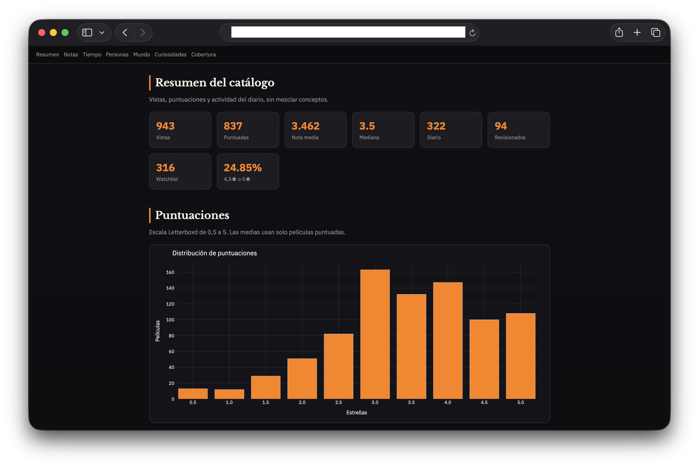
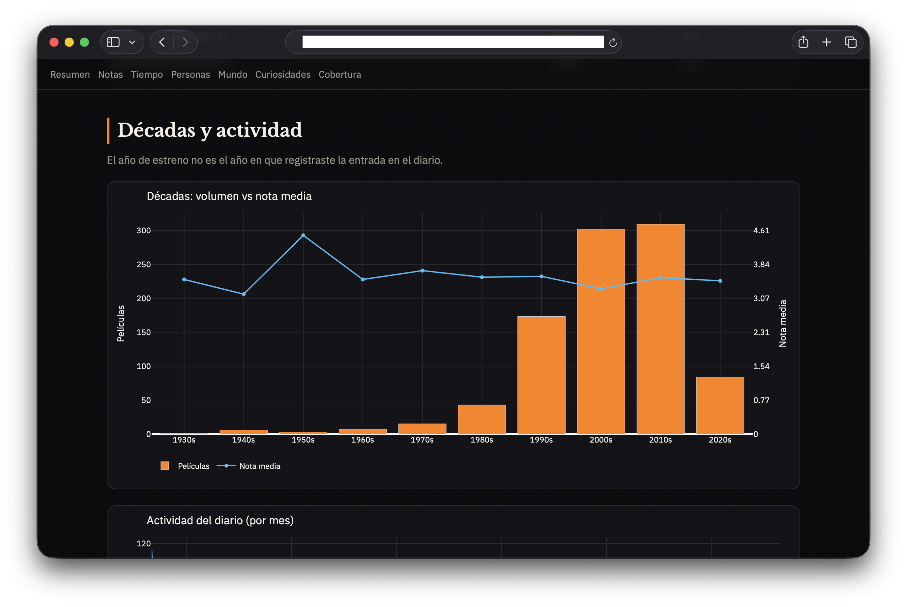
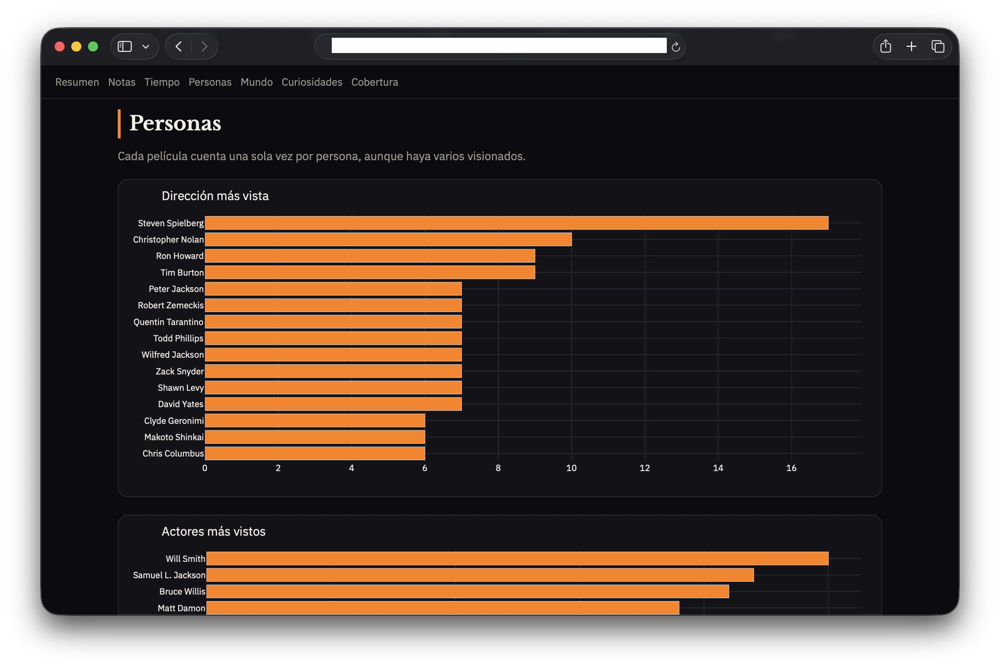
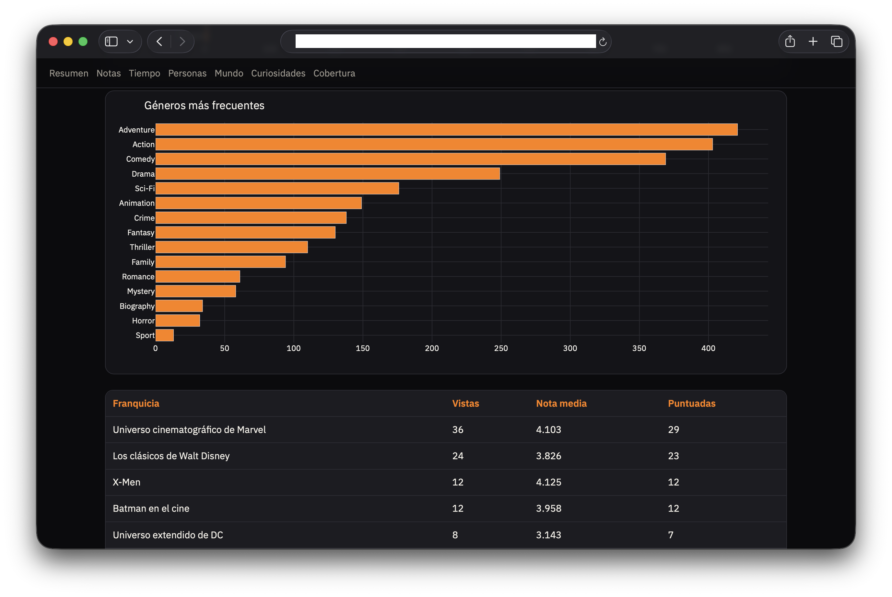
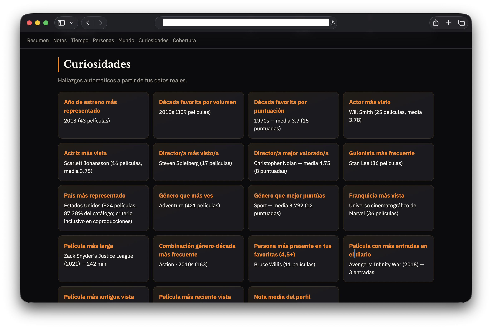

# Letterboxd Wrapped

Análisis tipo *Wrapped* a partir de una exportación ZIP de Letterboxd: estadísticas básicas, enriquecimiento con datasets públicos de IMDb (y opcionalmente Wikidata/TMDB), rankings cinéfilos, informe HTML y libro Excel.

## Capturas del informe HTML

Ejemplo del informe generado (`letterboxd_wrapped.html`). Las imágenes están en [`docs/screenshots/`](docs/screenshots/).

### Resumen y puntuaciones

Tarjetas del catálogo (vistas, puntuadas, media, diario, watchlist…) y distribución de notas en la escala Letterboxd (0,5–5).



### Décadas y actividad

Volumen de películas vs nota media por década de estreno, y evolución del diario por mes (distinto del año de estreno).



### Personas

Rankings de dirección, actores y actrices más vistos; cada película cuenta una sola vez por persona.



### Géneros y franquicias

Géneros más frecuentes y tabla de franquicias/colecciones (vistas, nota media, puntuadas).



### Curiosidades

Hallazgos del perfil: década favorita, personas, país, género, franquicia, película más revisionada, etc.



## Requisitos

- Python 3.11+
- Una exportación de Letterboxd (`Settings → Import & Export → Export your data`)

## Instalación

```bash
python3.11 -m venv .venv
source .venv/bin/activate
pip install -r requirements.txt
pip install -e .
```

Copia `.env.example` a `.env` si quieres usar TMDB (opcional):

```bash
cp .env.example .env
# Edita TMDB_API_KEY si la tienes
```

## Uso

```bash
python -m letterboxd_wrapped \
  --input ./letterboxd-XXXX.zip \
  --output ./output \
  --coverage-summary
```

### Opciones útiles

| Opción | Descripción |
|--------|-------------|
| `--basic-only` | Solo estadísticas de Letterboxd (sin IMDb/Wikidata) |
| `--offline` | Reutiliza caché/datasets ya descargados |
| `--force-refresh` | Regenera matching y metadatos |
| `--limit N` | Limita películas (pruebas) |
| `--excel-only` / `--html-only` | Genera un solo informe |
| `--no-wikidata` | Omite países/franquicias vía Wikidata |
| `--cache-dir` / `--imdb-dir` | Rutas de caché y datasets IMDb |

## Salidas

En `--output` (por defecto `./output`):

- `letterboxd_wrapped.xlsx` — libro con hojas de resumen, rankings y cobertura
- `letterboxd_wrapped.html` — informe visual autocontenido
- `summary.json` — resumen máquina-legible

## Fuentes de metadatos

1. **Letterboxd export** — vistas, ratings, diario, watchlist, likes, listas.
2. **IMDb datasets** (`https://datasets.imdbws.com/`) — título, año, géneros, duración, tipo, dirección, guion, actor/actriz (categorías oficiales). Uso local; no se redistribuyen los ficheros.
3. **Wikidata SPARQL** (opcional) — países de producción y colecciones/franquicias.
4. **TMDB API** (opcional, `TMDB_API_KEY`) — completa países, idioma y colecciones.

No se hace scraping de Letterboxd ni de IMDb web.

## Exactitud

- Las medias usan **solo películas puntuadas**.
- Los rankings de personas cuentan **películas distintas**, no revisionados.
- Coincidencias dudosas van a `Correspondencias pendientes` (no se inventan datos).
- Actor/actriz se separan con categorías IMDb; dirección no se parte por género inferido.

## Pruebas

```bash
pytest -q
```

## Repetir el análisis

1. Descarga un ZIP nuevo desde Letterboxd.
2. Ejecuta el mismo comando apuntando al nuevo ZIP.
3. Con `--offline` reutilizas datasets IMDb ya bajados; sin él, solo se descargan si faltan.
